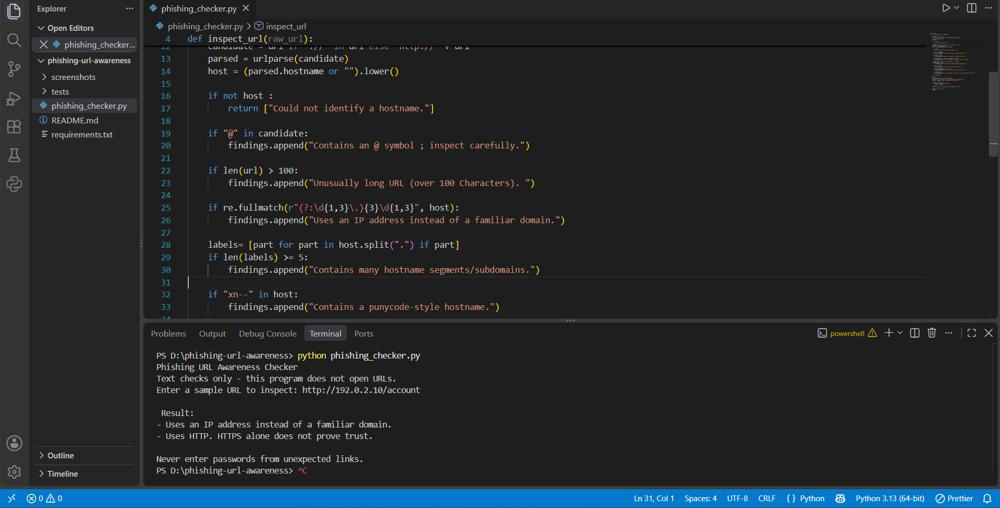
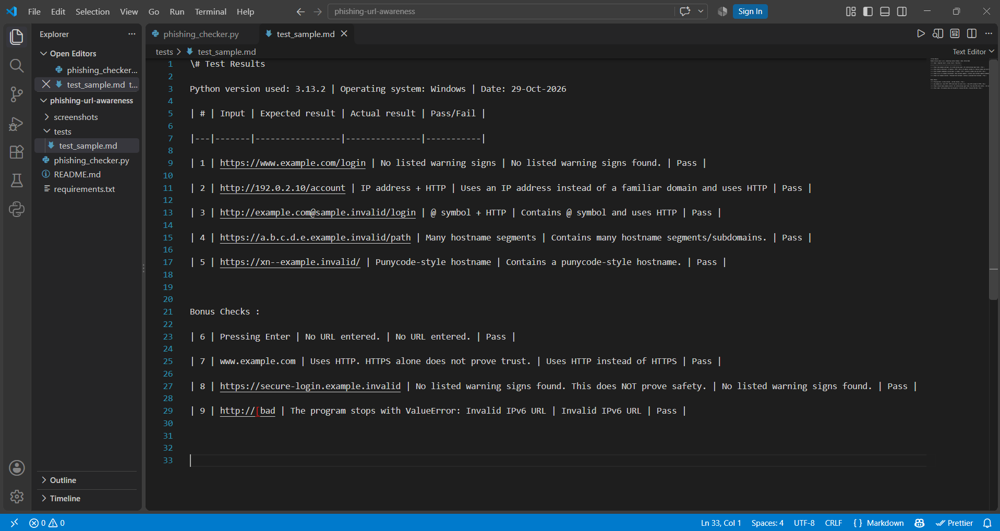

# EWB Phishing URL Awareness Checker

## Overview
Phishing is a trick where criminals send fake links or messages to make people share passwords, card numbers or OTPs. This project is a small command-line tool written in Python that reads the text of a URL and points out a few visible warning signs. It never opens the URL, scans a website or sends any data anywhere.

## Features
- Detects an @ symbol in the URL
- Flags unusually long URLs (over 100 characters)
- Flags IP-address hostnames
- Flags many hostname segments (5 or more)
- Flags punycode-style hostnames (xn--)
- Flags the HTTP scheme
- Interactive loop: check several URLs in one run and type `q` to quit
- Safe handling of malformed input, so the program shows a clear message instead of crashing

## Requirements
Python 3.10 or later. No extra packages are needed.

## How to Run
Windows:

```
python phishing_checker.py
```

Mac/Linux:

```
python3 phishing_checker.py
```

## Example Output
```
EWB Phishing URL Awareness Checker
Text checks only - this program does not open URLs.

Enter a sample URL (or type q to quit): http://192.0.2.10/account

Result:
- Uses an IP address instead of a familiar domain.
- Uses HTTP. HTTPS alone does not prove trust.
Never enter passwords from unexpected links.

Enter a sample URL (or type q to quit): q
Goodbye! Stay alert online.
```

## Testing
Full table with details is in `tests/test_samples.md`.

| # | Input | Expected | Actual | Result |
|---|-------|----------|--------|--------|
| 1 | https://www.example.com/login | No warning signs | No listed warning signs found. This does NOT prove safety. | PASS |
| 2 | http://192.0.2.10/account | IP address + HTTP | Uses an IP address instead of a familiar domain. Uses HTTP. | PASS |
| 3 | http://example.com@sample.invalid/login | @ symbol + HTTP | Contains an @ symbol; inspect carefully. Uses HTTP. | PASS |
| 4 | https://a.b.c.d.e.example.invalid/path | Many hostname segments | Contains many hostname segments/subdomains. | PASS |
| 5 | https://xn--example.invalid/ | Punycode-style hostname | Contains a punycode-style hostname. | PASS |
| 6 | http://[bad | Clear error message, no crash | This text is not a valid URL format. | PASS |

Test 6 is an extra test for Improvement . I re-ran tests 1 to 5 after adding both improvements to make sure nothing broke.

## Screenshots



## Improvements
1. **Loop with quit** - I replaced the single-run `main()` with a `while True` loop. Before, the program closed after one URL and had to be restarted every time. Now it keeps asking for URLs until I type `q`, `quit` or `exit`. I tested it by checking several URLs in one run and then quitting with `q`.
2. **Malformed input handling** - Typing `http://[bad` used to crash the program with `ValueError: Invalid IPv6 URL`. I wrapped `urlparse(candidate)` in a `try/except ValueError` block, so the program now prints "This text is not a valid URL format." and keeps running. I tested it by typing `http://[bad` and then re-running all five original tests.

## Limitations
This is an educational tool. It only reads URL text. It does not visit URLs, scan for malware or prove that a URL is safe. No warning signs found does NOT mean a URL is safe. For example, a link with a slightly misspelled brand name can pass all six checks.

## Ethical Use
Use sample strings only. Do not collect credentials. Do not use this project to deceive anyone or to test websites without permission.

## Author
Saurabh Tripathi, AI Powered Cybersecurity Internship, EWB Courses
